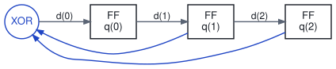

# D06 · Takt für Takt von Hand simulieren

6 min · zurück: [D05](D05_synchronisierer.md) · weiter: [D07](D07_flankenerkennung.md)

## Ziel
Den Ablauf einer getakteten Schaltung in eine
Tabelle eintragen – typische „Fleißaufgabe“ mit
sicheren Punkten.

## Erklärung
Vorgehen:
1. Startwert nach Reset notieren.
2. **Kombinatorik** aus dem *aktuellen* Registerwert
   berechnen (`d = f(q)`).
3. Bei der Flanke: `q ← d`.
4. Wiederholen.

Wichtig: Alle FFs übernehmen **gleichzeitig** –
immer mit den Werten **vor** der Flanke rechnen.

## Aufgabe
3-Bit-Register `q(2 downto 0)`, Reset auf `"001"`:
```vhdl
d(2) <= q(1);
d(1) <= q(0);
d(0) <= q(2) xor q(1);
```



Gib `q` nach den ersten **5** steigenden Flanken an.

<details><summary>Lösung</summary>

| Flanke | q vorher | d = (q1, q0, q2⊕q1) | q nachher |
|---|---|---|---|
| 1 | 001 | 0, 1, 0⊕0 | **010** |
| 2 | 010 | 1, 0, 0⊕1 | **101** |
| 3 | 101 | 0, 1, 1⊕0 | **011** |
| 4 | 011 | 1, 1, 0⊕1 | **111** |
| 5 | 111 | 1, 1, 1⊕1 | **110** |

(Danach 100, dann wieder 001: ein **LFSR** mit
Periode 7 = 2³−1.)
</details>

## Klausur
**F24 A1 F4** (CRC-Werte nach 5 Flanken),
H19 A2 F4/F5 (FIFO-Inhalt nach jeder Flanke),
F23 A1 F3, F23 A2 F3/F8.
