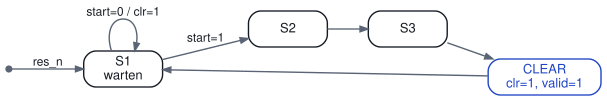

# F06 · Steuerwerk + Rechenwerk

7 min · zurück: [F05](F05_defaults.md) · weiter: [F07](F07_tabelle_als_array.md)

## Ziel
Verstehen, wie ein Automat (Steuerwerk) einen
Datenpfad (Rechenwerk) über Steuersignale lenkt.

## Erklärung
Typisches Klausurbild:
```
 start ─▶ [ Steuerwerk ] ─ clr, sel ─▶ [ Rechenwerk ] ─▶ crc
              (FSM)          valid ◀─      (Register + Mux)
```
- Das **Rechenwerk** besteht aus Registern,
  Multiplexern, Addierern … (Blöcke A–D).
- Das **Steuerwerk** ist ein Automat, dessen
  **Ausgänge** die Steuersignale sind (Mux-Auswahl,
  Enable, Clear, Valid).
- Pro Zustand überlegen: Welche Steuersignale müssen
  in diesem Takt welchen Wert haben?

Beispiel (vereinfacht aus F24): 3 Takte rechnen,
dann Register löschen. Zustände `S1, S2, S3, CLEAR`.
`S1` wartet auf `start`.

| Zustand | nächster | clr | valid |
|---|---|---|---|
| S1 | S2 wenn start, sonst S1 | 1 wenn **nicht** start | 0 |
| S2 | S3 | 0 | 0 |
| S3 | CLEAR | 0 | 0 |
| CLEAR | S1 | 1 | 1 |



## Aufgabe
Schreibe `output_p` für die Tabelle (Mealy, weil
`clr` in S1 von `start` abhängt). Nutze Defaults.

<details><summary>Lösung</summary>

```vhdl
output_p: process(current_state, start) is
begin
  clr   <= '0';
  valid <= '0';
  case current_state is
    when S1 =>
      if start /= '1' then
        clr <= '1';
      end if;
    when S2 | S3 =>
      null;
    when CLEAR =>
      valid <= '1';
      clr   <= '1';
  end case;
end process output_p;
```
</details>

## Klausur
**F24 A1 F7–F9** (calc_11bit_crc, 4 Takte: 3 rechnen +
1 löschen). Siehe auch K02.
