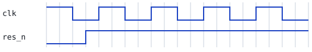

# I01 · Takt- und Reset-Generator

5 min · zurück: [H06](H06_rom_init_funktion.md) · weiter: [I02](I02_wait.md)

## Ziel
Takt und Reset für eine Simulation erzeugen.

## Erklärung
Die Komponente aus dem Skript:
```vhdl
entity clk_res_gen is
  port(
    clk   : out std_logic;
    res_n : out std_logic
    );
end entity clk_res_gen;

architecture behav of clk_res_gen is
  constant T : time := 20 ns;    -- 50 MHz
begin
  process is
  begin
    clk <= '1'; wait for T/2;
    clk <= '0'; wait for T/2;
  end process;                   -- Endlosschleife

  process is
  begin
    res_n <= '0'; wait for 0.75 * T;
    res_n <= '1'; wait;          -- für immer
  end process;
end architecture behav;
```



- Prozesse **ohne** Sensitivitätsliste, gesteuert
  durch `wait`.
- Reset endet bei 0,75 T – **nicht** auf einer
  Taktflanke (bei 0, T/2, T, …), damit es kein
  Wettrennen gibt.
- `time`-Rechnung: `T/2`, `0.75 * T`, `3 * T`.
- Der Taktprozess endet nie → Simulation mit
  Stoppzeit beenden oder den Takt über ein Signal
  abschalten.

## Aufgabe
1. Welche Frequenz hat ein Takt mit `T = 8 ns`?
2. Schreibe einen Taktprozess, der stoppt, sobald
   das Signal `ende` (boolean) `true` wird.

<details><summary>Lösung</summary>

1. 1 / 8 ns = **125 MHz**.

```vhdl
process is
begin
  while not ende loop
    clk <= '1'; wait for T/2;
    clk <= '0'; wait for T/2;
  end loop;
  wait;
end process;
```
</details>

## Klausur
Skript Kap. 2.3.5, F19 A1 F2 (`clock_reset: entity
clk_res_gen`), F23 A2 F4 (50 MHz-Rechnung).
