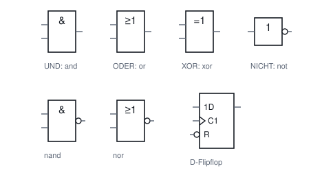

# L01 · Schaltpläne lesen: DIN-Symbole

5 min · zurück: [G06](G06_if_generate_rekursion.md) · weiter: [L02](L02_behav_struct.md)

## Ziel
Jedes Gatter- und Flipflop-Symbol nach DIN EN 60617 sofort in VHDL übersetzen.

## Erklärung
Deutsche Schaltpläne (Skript, Klausur) nutzen **Rechtecksymbole**. Was das Gatter tut, steht **im** Kasten:

| Symbol im Kasten | Funktion | VHDL |
|---|---|---|
| `&` | UND | `and` |
| `≥1` | ODER (mindestens ein Eingang 1) | `or` |
| `=1` | XOR (genau ein Eingang 1) | `xor` |
| `1` | Treiber / NICHT mit Kreis | `not` |
| `&` mit Kreis | NAND | `nand` |
| `≥1` mit Kreis | NOR | `nor` |

- Der **Kreis** (Inversionspunkt) bedeutet `not` – am Ausgang oder an einem Eingang.
- **Flipflop**: `1D` = Dateneingang, `C1` = Takt, das **Dreieck** heißt flankengesteuert (steigende Flanke), `R` = Reset. Ein Kreis vor `R` heißt **low-aktiv** → genau unser `res_n`.
- **Punkt** auf einer Kreuzung = Verbindung. Kreuzung **ohne** Punkt = keine Verbindung.

## Aufgabe
1. Welcher VHDL-Operator gehört zu `≥1` mit Kreis am Ausgang?
2. Ein Flipflop hat einen Kreis vor `R`. Mit welchem Wert von `res_n` wird es zurückgesetzt?
3. Zwei Leitungen kreuzen sich ohne Punkt. Sind sie verbunden?
4. Schreibe eine Zeile VHDL für ein `&`-Gatter mit drei Eingängen `a, b, c` und Kreis am Ausgang `y`.

Lösung

1. `nor`
2. Mit `res_n = '0'` (low-aktiv).
3. **Nein.** Nur ein Punkt verbindet.
4. `y <= not (a and b and c);`

## Klausur
In fast jeder Klausur steht ein „Bild“ mit Schaltplan, aus dem du Code machst, z.B. **F24 A1 F1** (`single_step`, siehe A03), F20 A1 F9 (Schaltplan selbst zeichnen), Skript Kap. 2.3.4.
