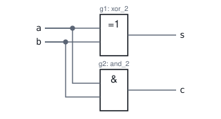

# L02 · behav, struct, mixed: der Unterschied

6 min · zurück: [L01](L01_din_symbole.md) · weiter: [L03](L03_plan_zu_behav.md)

## Ziel
Wissen, was eine Verhaltens- und was eine Strukturbeschreibung ist und wann man welche schreibt.

## Erklärung
Zu **einer** Entity kann es mehrere Architectures geben. Die Namen sind Konvention, aber in Skript und Klausur festgelegt:

| Name | beschreibt | enthält |
|---|---|---|
| `behav` | **was** die Schaltung tut | Zuweisungen, `when`, `with`, Prozesse |
| `struct` | **woraus** sie gebaut ist | nur Instanzen, verbunden über Signale (eine Netzliste) |
| `mixed` | beides | Instanzen **und** Zuweisungen/Prozesse |

Derselbe Halbaddierer zweimal:



```vhdl
architecture behav of halbaddierer is
begin
  s <= a xor b;
  c <= a and b;
end architecture behav;

architecture struct of halbaddierer is
begin
  g1: entity work.xor_2 port map(x0 => a, x1 => b, y => s);
  g2: entity work.and_2 port map(x0 => a, x1 => b, y => c);
end architecture struct;
```
- Die Synthese erzeugt aus beiden **dieselbe Schaltung** (Skript Kap. 2.3.8).
- `struct` nimmst du, wenn ein Schaltplan oder Blockbild vorgegeben ist, und für Hierarchie (Module aus Modulen).
- `behav` ist kürzer und nimmst du, wenn nur die Funktion zählt.
- Auswahl beim Instanziieren: `entity work.halbaddierer(struct)`.

## Aufgabe
Welche Art von Architecture ist das jeweils?
1. Nur `port map`-Instanzen und Signaldeklarationen.
2. Ein Prozess mit `case`.
3. Eine Instanz von `single_step` plus ein getakteter Prozess für das Register.
4. Was passiert bei `entity work.halbaddierer` **ohne** Klammer, wenn es zwei Architectures gibt?

<details><summary>Lösung</summary>

1. `struct`
2. `behav`
3. `mixed` (genau so heißt sie in **F24 A1 F3**)
4. Es wird die **zuletzt analysierte** Architecture genommen. Deshalb bei mehreren Architectures immer explizit angeben.
</details>

## Klausur
„Geben Sie eine Architecture struct … in Form einer Strukturbeschreibung an“ (F19 A1 F2, F20 A1 F1b), „Architecture mixed“ (F24 A1 F3/F9), „Verhaltensbeschreibung“ (F24 A1 F1b).

Am Rechner (Repo-Ordner): `am_rechner/L10/kombinatorik.vhd`
