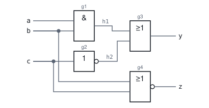

# L03 · Vom Schaltplan zur Verhaltensbeschreibung

6 min · zurück: [L02](L02_behav_struct.md) · weiter: [L04](L04_plan_zu_struct.md)

## Ziel
Aus einem Gatterplan die Gleichungen ablesen und als `behav` schreiben.

## Erklärung
Vorgehen: **Von jedem Ausgang rückwärts** zu den Eingängen gehen und dabei den Ausdruck von innen nach außen aufbauen.



Für `y`: `g3` ist ein ODER aus `h1` und `h2`.
- `h1` kommt aus `g1`: `a and b`
- `h2` kommt aus `g2`: `not c`
- also `y <= (a and b) or (not c);`

Regeln:
- **Immer klammern**, `and` und `or` haben in VHDL denselben Rang.
- Zwischenleitungen (`h1`, `h2`) brauchst du in `behav` **nicht** – du setzt ihre Ausdrücke direkt ein.
- Ein Kreis am Ausgang wird zu `nand`/`nor` oder `not (…)`.

## Aufgabe
Entity `netz` mit Eingängen `a, b, c` und Ausgängen `y, z` (alle `std_logic`).
Schreibe `architecture behav` für den Schaltplan oben (beide Ausgänge).

<details><summary>Lösung</summary>

```vhdl
architecture behav of netz is
begin
  y <= (a and b) or (not c);
  z <= b nor c;
end architecture behav;
```
`z <= not (b or c);` ist gleichwertig.
</details>

## Klausur
**F24 A1 F1b** (Architecture behav für das kombinatorische Netzwerk in Bild 1), H19 A1 F10.
