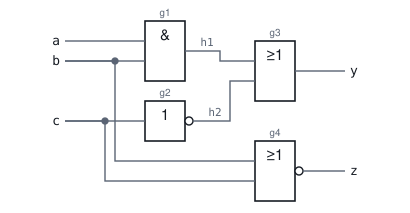

# L04 · Vom Schaltplan zur Strukturbeschreibung

7 min · zurück: [L03](L03_plan_zu_behav.md) · weiter: [L05](L05_signale_leitungen.md)

## Ziel
Denselben Plan als Netzliste aus Gatter-Instanzen schreiben.

## Erklärung


Vorhandene Gatter (Bibliothek `work`, Ports wie im Skript):
`not_1(x; y)`, `and_2(x0, x1; y)`, `or_2(x0, x1; y)`, `nor_2(x0, x1; y)`, `xor_2(x0, x1; y)`

Rezept in drei Schritten:
1. **Jedes Gatter** wird eine Instanz, das Label aus dem Plan (`g1` …) übernehmen.
2. **Jede innere Leitung** (nicht Port) wird ein Signal: hier `h1`, `h2`.
3. **Port map mit Namen**: links der Gatter-Port, rechts deine Leitung.

Eingänge (`a`, `b`, `c`) und Ausgänge (`y`, `z`) sind Ports und schon da – sie werden nicht deklariert.

## Aufgabe
Schreibe `architecture struct of netz` für den Plan.

<details><summary>Lösung</summary>

```vhdl
architecture struct of netz is
  signal h1, h2 : std_logic;
begin
  g1: entity work.and_2 port map(x0 => a, x1 => b, y => h1);
  g2: entity work.not_1 port map(x => c, y => h2);
  g3: entity work.or_2  port map(x0 => h1, x1 => h2, y => y);
  g4: entity work.nor_2 port map(x0 => b, x1 => c, y => z);
end architecture struct;
```
Check: 4 Gatter = 4 Instanzen? 2 innere Leitungen = 2 Signale? Jeder Ausgang genau einmal getrieben?
</details>

## Klausur
Skript Kap. 2.3.4 (Zähler aus `not_1`, `and_2`, `xor_2`, `d_ff`), **F24 A1 F3**, F20 A1 F9.
