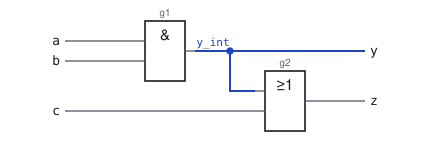

# L05 · Signale sind Leitungen

6 min · zurück: [L04](L04_plan_zu_struct.md) · weiter: [L06](L06_text_plan_code.md)

## Ziel
Sicher entscheiden, welche Signale du brauchst und wie du sie verbindest.

## Erklärung
- Jede **innere Leitung** im Plan ist ein `signal`, deklariert zwischen `architecture … is` und `begin`, mit passendem Typ und passender Breite.
- **Ports** sind bereits Signale – nicht nochmal deklarieren.
- **Ein Treiber pro Leitung** (B04). Eine Leitung darf aber zu **vielen** Eingängen gehen (Fan-out, im Plan ein Punkt).
- Ein `out`-Port darf in VHDL-93 **nicht gelesen** werden. Wird ein Ausgang auch intern gebraucht, treibt das Gatter ein **internes Signal**, das dann auf den Port geht:



- Gute Namen: wie im Plan, sonst sprechend (`taste_sync`, `carry`, `q0_int`).
- Ausgang einer Instanz bewusst unbenutzt: `y => open`. Eingänge **müssen** verbunden sein (notfalls mit `'0'`).

## Aufgabe
Entity `netz2` (Eingänge `a, b, c`, Ausgänge `y, z`). Schreibe die Architecture für den Plan oben mit `and_2` und `or_2`.
Warum kannst du `g2` nicht direkt mit dem Port `y` verbinden?

<details><summary>Lösung</summary>

```vhdl
architecture struct of netz2 is
  signal y_int : std_logic;
begin
  g1: entity work.and_2 port map(x0 => a, x1 => b, y => y_int);
  g2: entity work.or_2  port map(x0 => y_int, x1 => c, y => z);
  y <= y_int;
end architecture struct;
```
`y` ist ein `out`-Port und darf nicht gelesen werden – `g2` müsste ihn aber als Eingang lesen. (Streng genommen ist das wegen `y <= y_int;` schon `mixed`; so macht es auch das Skript beim Zähler mit `q0 <= q0_int;`.)
</details>

## Klausur
Genau dieses Muster: F24 A1 F3 (`crc <= q;`), Skript Kap. 2.3.4 (`q0_int`).
