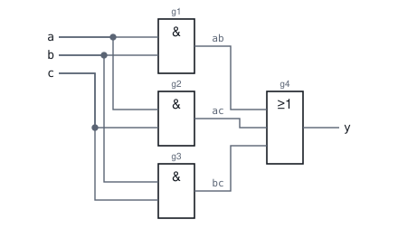

# L06 · Vom Text über den Plan zum Code

7 min · zurück: [L05](L05_signale_leitungen.md) · weiter: [L07](L07_hierarchie.md)

## Ziel
Aus einer Textbeschreibung selbst Gleichung, Schaltplan, `behav` und `struct` entwickeln.

## Erklärung
Vier Schritte:
1. **Wahrheitstabelle** aus dem Text
2. **Gleichung** (Minterme, dann vereinfachen)
3. **Schaltplan** (ein Gatter pro Operator)
4. **Code**: `behav` aus der Gleichung, `struct` aus dem Plan

Spezifikation: *Drei Schiedsrichter `a, b, c` stimmen ab. `y` ist 1, wenn **mindestens zwei** mit 1 stimmen.* (Mehrheitsentscheider)

| a b c | y |
|---|---|
| 0 0 0 / 0 0 1 / 0 1 0 / 1 0 0 | 0 |
| 0 1 1 / 1 0 1 / 1 1 0 / 1 1 1 | 1 |

## Aufgabe
1. Gib eine möglichst einfache Gleichung für `y` an.
2. Schreibe `architecture behav of mehrheit` (eine Zeile).
3. Schreibe `architecture struct of mehrheit` mit drei `and_2` und einem `or_3` (`x0, x1, x2; y`). Benenne die Leitungen `ab`, `ac`, `bc`.

<details><summary>Lösung</summary>

1. `y = ab + ac + bc` (jedes Paar, das 1 ist, reicht)



```vhdl
architecture behav of mehrheit is
begin
  y <= (a and b) or (a and c) or (b and c);
end architecture behav;

architecture struct of mehrheit is
  signal ab, ac, bc : std_logic;
begin
  g1: entity work.and_2 port map(x0 => a, x1 => b, y => ab);
  g2: entity work.and_2 port map(x0 => a, x1 => c, y => ac);
  g3: entity work.and_2 port map(x0 => b, x1 => c, y => bc);
  g4: entity work.or_3  port map(x0 => ab, x1 => ac, x2 => bc, y => y);
end architecture struct;
```
</details>

## Klausur
Freie Entwurfsaufgaben wie H19 A1 (Prioritätsencoder aus der Funktionsbeschreibung), F20 A2 F1–F3 (Decoder, Multiplexer).
