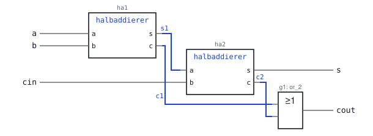

# L07 · Hierarchie: Module aus Modulen

7 min · zurück: [L06](L06_text_plan_code.md) · weiter: [L08](L08_multiplexer.md)

## Ziel
Eine Schaltung aus eigenen Modulen zusammensetzen, die selbst wieder aus Modulen bestehen.

## Erklärung
Ein Volladdierer aus zwei Halbaddierern und einem ODER:



- Über dem Block steht der **Instanzname** (`ha1`), im Block der **Modulname** (`halbaddierer`).
- Die Leitungen zwischen den Blöcken (`s1`, `c1`, `c2`) werden Signale.
- Hierarchie: `volladdierer` → `halbaddierer` → `xor_2`/`and_2`. Jede Ebene ist für sich testbar.
- Welche Architecture des Untermoduls benutzt wird, legst du mit `(struct)` oder `(behav)` fest.

## Aufgabe
1. Schreibe `architecture struct of volladdierer` (Ports `a, b, cin; s, cout`) nach dem Plan.
2. Szenario 2: Baue daraus `addierer_2bit` mit `a, b : std_logic_vector(1 downto 0)`, `s` (2 Bit) und `cout`. Der Übertrag der unteren Stufe heißt `c1`, der Eingangsübertrag ist `'0'`.

<details><summary>Lösung</summary>

```vhdl
architecture struct of volladdierer is
  signal s1, c1, c2 : std_logic;
begin
  ha1: entity work.halbaddierer(struct)
    port map(a => a, b => b, s => s1, c => c1);
  ha2: entity work.halbaddierer(struct)
    port map(a => s1, b => cin, s => s, c => c2);
  g1: entity work.or_2 port map(x0 => c1, x1 => c2, y => cout);
end architecture struct;

architecture struct of addierer_2bit is
  signal c1 : std_logic;
begin
  va0: entity work.volladdierer
    port map(a => a(0), b => b(0), cin => '0', s => s(0), cout => c1);
  va1: entity work.volladdierer
    port map(a => a(1), b => b(1), cin => c1, s => s(1), cout => cout);
end architecture struct;
```
Einzelbits eines Vektors verbindest du mit `a(0)`, Konstanten direkt mit `'0'`.
</details>

## Klausur
F20 A1 Bild 4 (Multiplizierwerk aus Volladdierern), F23 A1 F7 (`det_plru_element` aus zwei Komponenten), G05 (dasselbe mit `generate`).
