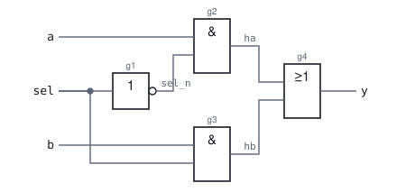
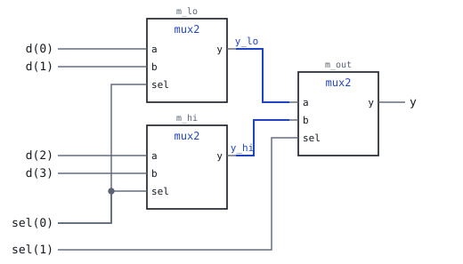

# L08 · Multiplexer: Gatter, Verhalten, Baustein

8 min · zurück: [L07](L07_hierarchie.md) · weiter: [L09](L09_getaktete_plaene.md)

## Ziel
Dieselbe Funktion auf drei Ebenen beschreiben: Gatter, Verhalten, aus Bausteinen.

## Erklärung
Ein 2:1-Multiplexer `y = a` bei `sel = '0'`, sonst `y = b` besteht aus vier Gattern:



Daraus baut man größere Multiplexer, ohne die Gatter neu zu zeichnen:



`sel(0)` wählt in beiden ersten Stufen, `sel(1)` in der letzten.

## Aufgabe
Entity `mux2` (Eingänge `a, b, sel`, Ausgang `y`), Entity `mux4` (`d : std_logic_vector(3 downto 0)`, `sel : std_logic_vector(1 downto 0)`, `y`).
1. `architecture behav of mux2` mit `when … else`
2. `architecture struct of mux2` nach dem Gatterplan (Signale `sel_n`, `ha`, `hb`)
3. `architecture struct of mux4` aus drei `mux2`

<details><summary>Lösung</summary>

```vhdl
architecture behav of mux2 is
begin
  y <= a when sel = '0' else b;
end architecture behav;

architecture struct of mux2 is
  signal sel_n, ha, hb : std_logic;
begin
  g1: entity work.not_1 port map(x => sel, y => sel_n);
  g2: entity work.and_2 port map(x0 => a, x1 => sel_n, y => ha);
  g3: entity work.and_2 port map(x0 => b, x1 => sel, y => hb);
  g4: entity work.or_2  port map(x0 => ha, x1 => hb, y => y);
end architecture struct;

architecture struct of mux4 is
  signal y_lo, y_hi : std_logic;
begin
  m_lo:  entity work.mux2 port map(a => d(0), b => d(1), sel => sel(0), y => y_lo);
  m_hi:  entity work.mux2 port map(a => d(2), b => d(3), sel => sel(0), y => y_hi);
  m_out: entity work.mux2 port map(a => y_lo, b => y_hi, sel => sel(1), y => y);
end architecture struct;
```
</details>

## Klausur
**F20 A2 F3/F4** (4:1-Multiplexer, generische Variante), F19 A2 F7 (Lesemultiplexer), H19 A1 Bild 3.
