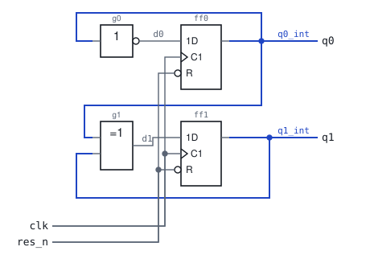

# L09 · Schaltpläne mit Flipflops

8 min · zurück: [L08](L08_multiplexer.md) · weiter: [L10](L10_modularisieren.md)

## Ziel
Einen getakteten Schaltplan als `struct` mit `d_ff`-Instanzen und als `behav` mit Prozess schreiben.

## Erklärung
Ein 2-Bit-Zähler wie im Skript (dort mit 3 Bit):



- `d0 = not q0`, `d1 = q0 xor q1`, beide Flipflops am selben `clk` und `res_n`.
- Die Ausgänge der Flipflops werden **zurückgeführt** → sie werden gelesen → internes Signal `q0_int`, `q1_int`, am Ende `q0 <= q0_int;`
- `d_ff` hat die Ports `clk, res_n, d, q` (D01).
- Für `behav` fasst du alle Flipflops in **einem** getakteten Prozess zusammen und schreibst die Gleichungen hinein.

## Aufgabe
Entity `zaehler2` mit `clk, res_n` (in) und `q0, q1` (out).
1. `architecture struct` mit `not_1`, `xor_2` und zwei `d_ff`
2. `architecture behav` mit einem Prozess

<details><summary>Lösung</summary>

```vhdl
architecture struct of zaehler2 is
  signal d0, d1, q0_int, q1_int : std_logic;
begin
  g0:  entity work.not_1 port map(x => q0_int, y => d0);
  g1:  entity work.xor_2 port map(x0 => q0_int, x1 => q1_int, y => d1);
  ff0: entity work.d_ff
    port map(clk => clk, res_n => res_n, d => d0, q => q0_int);
  ff1: entity work.d_ff
    port map(clk => clk, res_n => res_n, d => d1, q => q1_int);
  q0 <= q0_int;
  q1 <= q1_int;
end architecture struct;

architecture behav of zaehler2 is
  signal q0_int, q1_int : std_logic;
begin
  process(clk, res_n) is
  begin
    if res_n = '0' then
      q0_int <= '0';
      q1_int <= '0';
    else
      if clk'event and clk = '1' then
        q0_int <= not q0_int;
        q1_int <= q0_int xor q1_int;
      end if;
    end if;
  end process;
  q0 <= q0_int;
  q1 <= q1_int;
end architecture behav;
```
Beachte: Im Prozess liest `q1_int <= q0_int xor q1_int;` den **alten** Wert von `q0_int` – genau wie die Hardware (C02).
</details>

## Klausur
Skript Kap. 2.3.4–2.3.7 (`counter_3bit` als Struktur- und als Verhaltensbeschreibung), F21 A1 F2.

Am Rechner (Repo-Ordner): `am_rechner/L10/getaktet.vhd`
