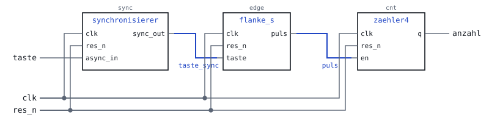

# L10 · Modularisieren: ein System schneiden

8 min · zurück: [L09](L09_getaktete_plaene.md) · weiter: [L11](L11_verdrahtungsfehler.md)

## Ziel
Ein System sinnvoll in Module zerlegen und die Schnittstellen festlegen.

## Erklärung
Aufgabe: *Zähle, wie oft eine (prellfreie, aber asynchrone) Taste gedrückt wurde.*

So schneidest du:
1. **Teilaufgaben finden**: einsynchronisieren (D05) → Flanke erkennen (D07) → zählen (D03)
2. **Ein Modul pro Teilaufgabe**, jedes einzeln test- und wiederverwendbar
3. **Schmale Schnittstellen**: nur die Ports, die wirklich nötig sind; Takt und Reset überall gleich benannt (`clk`, `res_n`)
4. **Top-Level nur verdrahten** (`struct`), keine Logik
5. Breiten und Grenzen als **Generic**, wenn das Modul mehrfach gebraucht wird (G04)



Faustregeln: Ein Modul hat **eine** Aufgabe, die sich in einem Satz sagen lässt. Steuerwerk (Automat) und Rechenwerk (Register, Zähler) trennt man (F06).

## Aufgabe
1. Gib die Entity `zaehler4` an (Ports wie im Bild, `q` 4 Bit).
2. Schreibe `architecture struct of tasten_zaehler` (Ports `clk, res_n, taste`; `anzahl` 4 Bit) mit den Signalen `taste_sync` und `puls`.

<details><summary>Lösung</summary>

```vhdl
library ieee; use ieee.std_logic_1164.all;

entity zaehler4 is
  port(
    clk, res_n : in  std_logic;
    en         : in  std_logic;
    q          : out std_logic_vector(3 downto 0)
    );
end entity zaehler4;

architecture struct of tasten_zaehler is
  signal taste_sync, puls : std_logic;
begin
  sync: entity work.synchronisierer
    port map(clk => clk, res_n => res_n,
             async_in => taste, sync_out => taste_sync);
  edge: entity work.flanke_s
    port map(clk => clk, res_n => res_n,
             taste => taste_sync, puls => puls);
  cnt:  entity work.zaehler4
    port map(clk => clk, res_n => res_n, en => puls, q => anzahl);
end architecture struct;
```
</details>

## Klausur
F24 A1 F9 (Gesamtschaltung aus Steuerwerk, `m_step`-Instanzen und Register), F23 A2 F6 (`keyboard_interface`), F21 A1 F8–F10 (LAB aus Logic Elements).

Am Rechner (Repo-Ordner): `am_rechner/L10/modular.vhd`
