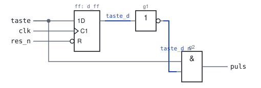

# L12 · Klausurtraining: Plan komplett umsetzen

9 min · zurück: [L11](L11_verdrahtungsfehler.md) · weiter: [H01](H01_funktionen.md)

## Ziel
Eine typische Klausuraufgabe am Stück lösen: Entity, Struktur, Verhalten und Einordnung.

## Erklärung
Gegeben ist dieser Plan einer Flankenerkennung (vgl. D07):



Vorgehen wie in der Klausur:
1. Entity aus den Ein- und Ausgängen des Plans
2. `struct`: Instanzen + Signale für jede innere Leitung
3. `behav`: Flipflop als Prozess, Gatter als Zuweisung
4. Fragen zum Verhalten beantworten

## Aufgabe
1. Gib die Entity `flanke_s` an.
2. Gib `architecture struct` an (`d_ff`, `not_1`, `and_2`).
3. Gib `architecture behav` an.
4. Welcher Automatentyp ist das? Begründe.

<details><summary>Lösung</summary>

```vhdl
library ieee; use ieee.std_logic_1164.all;

entity flanke_s is
  port(
    clk, res_n, taste : in  std_logic;
    puls              : out std_logic
    );
end entity flanke_s;

architecture struct of flanke_s is
  signal taste_d, taste_d_n : std_logic;
begin
  ff: entity work.d_ff
    port map(clk => clk, res_n => res_n, d => taste, q => taste_d);
  g1: entity work.not_1 port map(x => taste_d, y => taste_d_n);
  g2: entity work.and_2 port map(x0 => taste, x1 => taste_d_n, y => puls);
end architecture struct;

architecture behav of flanke_s is
  signal taste_d : std_logic;
begin
  process(clk, res_n) is
  begin
    if res_n = '0' then
      taste_d <= '0';
    else
      if clk'event and clk = '1' then
        taste_d <= taste;
      end if;
    end if;
  end process;
  puls <= taste and not taste_d;
end architecture behav;
```
4. **Mealy**: Der Ausgang `puls` hängt vom Zustand (`taste_d`) **und** direkt vom Eingang `taste` ab.
</details>

## Klausur
Aufbau wie **F24 A1 F1–F3** (Entity, Architecture, Automatentyp), F23 A2 F1/F2.

Am Rechner (Repo-Ordner): `am_rechner/L10/getaktet.vhd`
