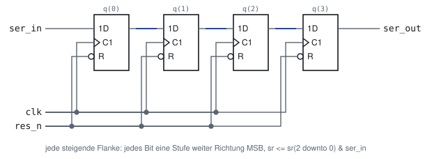

# M02 · Schieberegister: seriell und parallel

6 min · zurück: [M01](M01_register.md) · weiter: [M03](M03_zaehler_modulo.md)

## Ziel
Ein Universal-Schieberegister schreiben, das parallel lädt und seriell schiebt.

## Erklärung
Ein Schieberegister ist eine Kette von Flipflops:



In VHDL schreibt man nicht vier Flipflops, sondern **eine Zuweisung mit Konkatenation**:
```vhdl
sr <= sr(N-2 downto 0) & ser_in;   -- Richtung MSB
sr <= ser_in & sr(N-1 downto 1);   -- Richtung LSB
```
Mit `load` hat man ein **Universal-Schieberegister**: parallel laden (Parallel-Seriell-Wandler, z.B. Sender) oder seriell einschieben (Seriell-Parallel-Wandler, z.B. Empfänger).

```vhdl
entity schiebe_reg is
  generic(N : positive := 8);
  port(
    clk, res_n  : in  std_logic;
    load, shift : in  std_logic;
    din         : in  std_logic_vector(N-1 downto 0);
    ser_in      : in  std_logic;
    q           : out std_logic_vector(N-1 downto 0);
    ser_out     : out std_logic
    );
end entity schiebe_reg;
```

## Aufgabe
Schreibe `architecture behav`: `load` hat Vorrang vor `shift`, geschoben wird Richtung MSB, `ser_out` ist das MSB.

<details><summary>Lösung</summary>

```vhdl
architecture behav of schiebe_reg is
  signal sr : std_logic_vector(N-1 downto 0);
begin
  process(clk, res_n) is
  begin
    if res_n = '0' then
      sr <= (others => '0');
    else
      if clk'event and clk = '1' then
        if load = '1' then
          sr <= din;
        elsif shift = '1' then
          sr <= sr(N-2 downto 0) & ser_in;
        end if;
      end if;
    end if;
  end process;
  q       <= sr;
  ser_out <= sr(N-1);
end architecture behav;
```
Das interne Signal `sr` ist nötig, weil das Register sich selbst lesen muss.
Weiter üben: Eingang `rechts` für die Schieberichtung; Lauflicht (rotieren: `sr(N-2 downto 0) & sr(N-1)`).
</details>

## Klausur
F19 A1 (serieller Empfänger mit Schieberegister), D05 (Synchronisierer = Schieberegister der Länge 2), F24 A1 (CRC-Register mit Rückkopplung).
