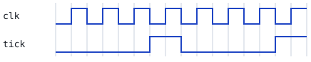

# M04 · Taktteiler als Enable-Puls

5 min · zurück: [M03](M03_zaehler_modulo.md) · weiter: [M05](M05_entpreller.md)

## Ziel
Langsamere Abläufe erzeugen, ohne einen zweiten Takt zu bauen.

## Erklärung
Falsch (aber verlockend): einen langsamen Takt `clk_langsam` erzeugen und Flipflops damit takten. Das ergibt mehrere Taktdomänen, Laufzeitprobleme und Glitches (Skript Kap. 6).

Richtig: **ein** Takt für alles, und ein Taktteiler liefert einen **Enable-Puls** `tick`, der jeden N-ten Takt für genau einen Takt `'1'` ist:



Andere Bausteine machen nur dann etwas, wenn `tick = '1'` ist (wie `en` in M01/M03).

```vhdl
entity taktteiler is
  generic(N : positive := 4);
  port(
    clk, res_n : in  std_logic;
    tick       : out std_logic
    );
end entity taktteiler;
```

## Aufgabe
1. Schreibe `architecture behav` mit einem Zähler `0 … N-1`.
2. Wie groß muss `N` sein, um aus 50 MHz einen Puls pro Millisekunde zu machen?

<details><summary>Lösung</summary>

```vhdl
architecture behav of taktteiler is
  signal cnt : integer range 0 to N-1;
begin
  process(clk, res_n) is
  begin
    if res_n = '0' then
      cnt <= 0;
    else
      if clk'event and clk = '1' then
        if cnt = N-1 then
          cnt <= 0;
        else
          cnt <= cnt + 1;
        end if;
      end if;
    end if;
  end process;
  tick <= '1' when cnt = N-1 else '0';
end architecture behav;
```
2. 50 MHz · 1 ms = **50 000** Takte → `N = 50000`.
</details>

## Klausur
F23 A2 F4 (Frequenz eines Oszillators bei 50 MHz berechnen), F19 A1 F4 (Bitzeit aus Baudrate).
