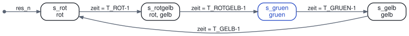

# M09 · Automat mit Timer: Ampel

8 min · zurück: [M08](M08_ram.md) · weiter: [M10](M10_sender.md)

## Ziel
Das häufigste Muster in der Praxis: ein Automat, der in jedem Zustand eine bestimmte Zeit wartet.

## Erklärung


Rezept „Automat + Zähler“:
- Ein Zähler `zeit` zählt, wie lange der Automat schon im aktuellen Zustand ist.
- Die **Übergangsfunktion** fragt `zeit` ab.
- Im **Zustandsprozess**: Wechselt der Zustand (`next_state /= current_state`), wird `zeit` auf 0 gesetzt, sonst hochgezählt.

```vhdl
entity ampel is
  generic(T_ROT : positive := 5; T_ROTGELB : positive := 1;
          T_GRUEN : positive := 4; T_GELB : positive := 2);
  port(
    clk, res_n       : in  std_logic;
    rot, gelb, gruen : out std_logic
    );
end entity ampel;
```

## Aufgabe
Schreibe die Architecture mit `transition_function`, `state` (inklusive Zähler `zeit`) und `output_function`.

<details><summary>Lösung</summary>

```vhdl
architecture behav of ampel is
  type state_type is (s_rot, s_rotgelb, s_gruen, s_gelb);
  signal current_state, next_state : state_type;
  signal zeit : integer range 0 to 31;
begin
  transition_function: process(current_state, zeit) is
  begin
    next_state <= current_state;
    case current_state is
      when s_rot =>
        if zeit = T_ROT - 1 then next_state <= s_rotgelb; end if;
      when s_rotgelb =>
        if zeit = T_ROTGELB - 1 then next_state <= s_gruen; end if;
      when s_gruen =>
        if zeit = T_GRUEN - 1 then next_state <= s_gelb; end if;
      when s_gelb =>
        if zeit = T_GELB - 1 then next_state <= s_rot; end if;
    end case;
  end process transition_function;

  state: process(clk, res_n) is
  begin
    if res_n = '0' then
      current_state <= s_rot;
      zeit <= 0;
    else
      if clk'event and clk = '1' then
        current_state <= next_state;
        if next_state /= current_state then
          zeit <= 0;
        else
          zeit <= zeit + 1;
        end if;
      end if;
    end if;
  end process state;

  output_function: process(current_state) is
  begin
    rot <= '0'; gelb <= '0'; gruen <= '0';
    case current_state is
      when s_rot     => rot <= '1';
      when s_rotgelb => rot <= '1'; gelb <= '1';
      when s_gruen   => gruen <= '1';
      when s_gelb    => gelb <= '1';
    end case;
  end process output_function;
end architecture behav;
```
Weiter üben: Fußgänger-Taste, die die Grünphase der Autos verkürzt.
</details>

## Klausur
F24 A1 F8 (Steuerwerk), F21 A2 (Linienzeichner mit Zählern), F23 A2 (Synthesizer-Steuerung).
