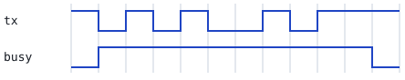

# M10 · Serieller Sender: alles zusammen

10 min · zurück: [M09](M09_ampel_timer.md) · weiter: [H01](H01_funktionen.md)

## Ziel
Schieberegister, Zähler und Ablaufsteuerung zu einem echten Baustein kombinieren.

## Erklärung
Ein serieller Sender (wie eine UART) schickt ein Byte Bit für Bit über eine Leitung:
- Ruhepegel `'1'`, dann **Startbit** `'0'`, dann **8 Datenbits, LSB zuerst**, dann **Stoppbit** `'1'`
- Jedes Bit liegt `BIT_TAKTE` Takte an (Bitzeit aus Baudrate, M04)



Bausteine darin:
- **Schieberegister** `sr` (10 Bit: Stopp & Daten & Start), bei jedem Bitende eine Stelle nach rechts (M02)
- **Taktzähler** `takt` für die Bitzeit (M04)
- **Bitzähler** `bitnr` 0 … 9 (M03)
- **Steuerbit** `aktiv` (Automat mit zwei Zuständen)

```vhdl
entity sender is
  generic(BIT_TAKTE : positive := 4);
  port(
    clk, res_n : in  std_logic;
    start      : in  std_logic;
    data       : in  std_logic_vector(7 downto 0);
    tx         : out std_logic;
    busy       : out std_logic
    );
end entity sender;
```

## Aufgabe
Schreibe `architecture behav`. Bei `start = '1'` (und nicht aktiv) wird `'1' & data & '0'` geladen. `tx` ist `sr(0)` während des Sendens, sonst `'1'`.

<details><summary>Lösung</summary>

```vhdl
architecture behav of sender is
  signal sr    : std_logic_vector(9 downto 0);
  signal bitnr : integer range 0 to 9;
  signal takt  : integer range 0 to BIT_TAKTE - 1;
  signal aktiv : std_logic;
begin
  process(clk, res_n) is
  begin
    if res_n = '0' then
      aktiv <= '0';
      sr    <= (others => '1');
      bitnr <= 0;
      takt  <= 0;
    else
      if clk'event and clk = '1' then
        if aktiv = '0' then
          if start = '1' then
            sr    <= '1' & data & '0';
            aktiv <= '1';
            bitnr <= 0;
            takt  <= 0;
          end if;
        elsif takt = BIT_TAKTE - 1 then
          takt <= 0;
          sr   <= '1' & sr(9 downto 1);
          if bitnr = 9 then
            aktiv <= '0';
          else
            bitnr <= bitnr + 1;
          end if;
        else
          takt <= takt + 1;
        end if;
      end if;
    end if;
  end process;
  tx   <= sr(0) when aktiv = '1' else '1';
  busy <= aktiv;
end architecture behav;
```
Weiter üben: Paritätsbit vor dem Stoppbit ergänzen (vgl. F19 A1 F9/F10); den passenden Empfänger mit Synchronisierer und Abtastung in Bitmitte schreiben.
</details>

## Klausur
**Frühjahr 2019, Aufgabe 1** (asynchrone serielle Schnittstelle: Empfänger, `send_byte`, Parität). Achtung: Dort sind Ruhe- und Startpegel anders herum definiert – immer die Aufgabenstellung lesen.
