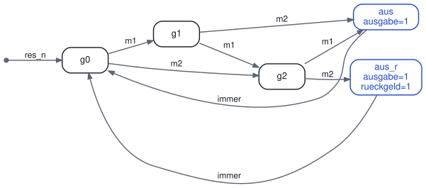

# P02 · Getränkeautomat: Zustandsdiagramm und Entity

7 min · zurück: [P01](P01_projekt_rezept.md) · weiter: [P03](P03_getraenk_code.md)

## Ziel
Aus dem Entwurf ein vollständiges Zustandsdiagramm und die Entity ableiten.

## Erklärung


So liest du das Diagramm:
- Kanten sind mit der **Eingabe** beschriftet, die den Übergang auslöst.
- Gibt es für eine Eingabe keine Kante (z.B. keine Münze), bleibt der Automat im Zustand.
- Die Ausgänge stehen **im Zustand** (Moore).
- `aus` und `aus_r` verlassen den Zustand **unbedingt** im nächsten Takt.

Vereinbarung: Kommen `m1` und `m2` gleichzeitig, gewinnt `m1` (Priorität im `if … elsif`). In der Klausur steht so etwas oft im Text – lies genau, sonst festlegen und hinschreiben.

## Aufgabe
1. Schreibe die **Übergangstabelle** (Zustand, `m1`, `m2` → Folgezustand) für `g1` und `g2`.
2. Schreibe die **Entity** `getraenk` mit `clk`, `res_n`, `m1`, `m2`, `ausgabe`, `rueckgeld` (alle `std_logic`).

<details><summary>Lösung</summary>

| Zustand | m1 | m2 | Folgezustand |
|---|---|---|---|
| g1 | 0 | 0 | g1 |
| g1 | 1 | – | g2 |
| g1 | 0 | 1 | aus |
| g2 | 0 | 0 | g2 |
| g2 | 1 | – | aus |
| g2 | 0 | 1 | aus_r |

```vhdl
library ieee;
use ieee.std_logic_1164.all;

entity getraenk is
  port(
    clk, res_n         : in  std_logic;
    m1, m2             : in  std_logic;
    ausgabe, rueckgeld : out std_logic
    );
end entity getraenk;
```
</details>

## Klausur
Zustandsdiagramme aus Text oder Code ableiten gehört zu fast jeder Automatenaufgabe (siehe auch F08).
