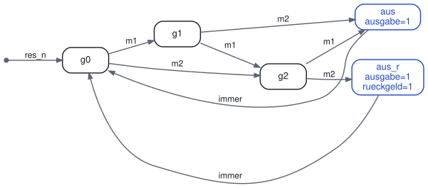

# P03 · Getränkeautomat: Architecture komplett

10 min · zurück: [P02](P02_getraenk_entwurf.md) · weiter: [P04](P04_getraenk_testbench.md)

## Ziel
Einen Moore-Automaten komplett ohne Vorlage programmieren.

## Erklärung
Das Schema aus Block F, diesmal schreibst du alles selbst:
- Aufzählungstyp `state_type` mit den Zuständen, zwei Signale `current_state`, `next_state`.
- `transition_function`: kombinatorisch, Sensitivität **alle** gelesenen Signale, Default `next_state <= current_state;`.
- `state`: getaktet mit asynchronem Reset auf `g0`.
- `output_function`: nur `current_state` in der Liste (Moore), Defaults `'0'`.



## Aufgabe
Schreibe `architecture behav of getraenk` vollständig.

<details><summary>Lösung</summary>

```vhdl
architecture behav of getraenk is
  type state_type is (g0, g1, g2, aus, aus_r);
  signal current_state, next_state : state_type;
begin
  transition_function: process(current_state, m1, m2) is
  begin
    next_state <= current_state;
    case current_state is
      when g0 =>
        if m1 = '1' then next_state <= g1;
        elsif m2 = '1' then next_state <= g2;
        end if;
      when g1 =>
        if m1 = '1' then next_state <= g2;
        elsif m2 = '1' then next_state <= aus;
        end if;
      when g2 =>
        if m1 = '1' then next_state <= aus;
        elsif m2 = '1' then next_state <= aus_r;
        end if;
      when aus | aus_r =>
        next_state <= g0;
    end case;
  end process transition_function;

  state: process(clk, res_n) is
  begin
    if res_n = '0' then
      current_state <= g0;
    else
      if clk'event and clk = '1' then
        current_state <= next_state;
      end if;
    end if;
  end process state;

  output_function: process(current_state) is
  begin
    ausgabe   <= '0';
    rueckgeld <= '0';
    case current_state is
      when aus    => ausgabe <= '1';
      when aus_r  => ausgabe <= '1';
                     rueckgeld <= '1';
      when others => null;
    end case;
  end process output_function;
end architecture behav;
```
Prüfe dich: Fehlt bei dir `m1` oder `m2` in der Sensitivitätsliste? Fehlt der Default für `next_state`? Beides kostet in der Klausur Punkte.
</details>

## Klausur
Automat nach Schema programmieren: wie im Steuerwerk aus F24 A1 (K02). Simulierbar in `am_rechner/L12/projekte_fsm.vhd`.
