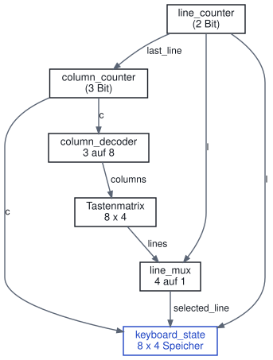

# P07 · Klausur F20: Tastatur-Controller – Decoder und Multiplexer

8 min · zurück: [P06](P06_codeschloss_code.md) · weiter: [P08](P08_tastatur_zaehler.md)

## Ziel
Die kombinatorischen Grundbausteine eines größeren Systems generisch schreiben.

## Erklärung
Nach **F20 A2** (sinngemäß): Eine Tastenmatrix mit 8 Spalten und 4 Zeilen wird abgefragt. Der Controller legt nacheinander **eine** Spalte auf `'1'` (Spalten-Decoder) und liest dann jede Zeile einzeln (Zeilen-Multiplexer). Ist eine Taste gedrückt, verbindet sie ihre Spalte mit ihrer Zeile.



Bausteine:
- `decoder` mit Generic `N`: Eingang `s(N-1 downto 0)`, Ausgang `o(2**N - 1 downto 0)`, genau das Bit mit der Nummer `s` ist `'1'` (One-hot).
- `mux` mit Generic `N`: Eingang `x(2**N - 1 downto 0)`, Auswahl `s(N-1 downto 0)`, Ausgang `y`.

Trick für beide: Index mit `to_integer(unsigned(s))`.

## Aufgabe
Schreibe Entity und Architecture `behav` für `decoder` und `mux`. Der Decoder braucht einen Prozess, der Multiplexer kommt mit einer Zeile aus.

<details><summary>Lösung</summary>

```vhdl
library ieee;
use ieee.std_logic_1164.all;

entity decoder is
  generic(N : positive);
  port(
    s : in  std_logic_vector(N-1 downto 0);
    o : out std_logic_vector(2**N - 1 downto 0)
    );
end entity decoder;

library ieee;
use ieee.numeric_std.all;

architecture behav of decoder is
begin
  process(s) is
  begin
    o <= (others => '0');
    o(to_integer(unsigned(s))) <= '1';
  end process;
end architecture behav;

library ieee;
use ieee.std_logic_1164.all;

entity mux is
  generic(N : positive);
  port(
    x : in  std_logic_vector(2**N - 1 downto 0);
    s : in  std_logic_vector(N-1 downto 0);
    y : out std_logic
    );
end entity mux;

library ieee;
use ieee.numeric_std.all;

architecture behav of mux is
begin
  y <= x(to_integer(unsigned(s)));
end architecture behav;
```
Beim Decoder überschreibt die zweite Zuweisung im Prozess das eine Bit – die letzte Zuweisung gewinnt (C02).
</details>

## Klausur
**F20 A2** (Tastatur, Decoder und Multiplexer). Simulierbar in `am_rechner/L12/projekte_klausur.vhd`.
