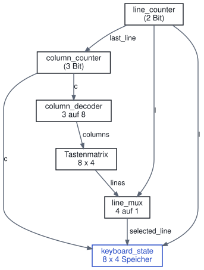

# P10 · Klausur F20: Tastatur-Controller verdrahten

9 min · zurück: [P09](P09_tastatur_speicher.md) · weiter: [P11](P11_empfaenger_rahmen.md)

## Ziel
Fünf Bausteine in einer `struct`-Architecture zu einem System verbinden.

## Erklärung


Vorgehen beim Verdrahten (L-Block):
1. Für jede **Verbindung zwischen zwei Instanzen** ein internes Signal deklarieren: `l`, `c`, `last_line`, `selected_line`.
2. Jede Instanz mit `entity work.… generic map(…) port map(…)` und Named Association.
3. Nicht benutzte Ausgänge: `=> open`. Nicht beschaltete Eingänge mit Default: einfach weglassen.
4. Ausgänge, die auch intern gebraucht werden, über ein Signal führen und am Ende zuweisen (`c_num <= c;`).

Entity:
```vhdl
entity keyboard_controller is
  port(
    clk, res_n  : in  std_logic;
    lines       : in  std_logic_vector(3 downto 0);
    columns     : out std_logic_vector(7 downto 0);
    c_num       : out std_logic_vector(2 downto 0);
    l_num       : out std_logic_vector(1 downto 0);
    key_changed : out std_logic;
    key_state   : out std_logic
    );
end entity keyboard_controller;
```

## Aufgabe
1. Schreibe `architecture struct of keyboard_controller` mit den Instanzen `line_counter`, `column_counter`, `column_decoder`, `line_mux`, `state`.
2. Die Tasten sind mechanische Schalter und die Leitungen `lines` kommen asynchron zum Takt herein. Was fehlt, und welchen Nachteil hat die Abhilfe?

<details><summary>Lösung</summary>

```vhdl
architecture struct of keyboard_controller is
  signal last_line, selected_line : std_logic;
  signal c : std_logic_vector(2 downto 0);
  signal l : std_logic_vector(1 downto 0);
begin
  line_counter: entity work.binary_counter
    generic map(N => 2)
    port map(clk => clk, res_n => res_n,
             q => l, max => last_line);
  column_counter: entity work.binary_counter
    generic map(N => 3)
    port map(clk => clk, res_n => res_n,
             inc => last_line, q => c, max => open);
  column_decoder: entity work.decoder
    generic map(N => 3)
    port map(s => c, o => columns);
  line_mux: entity work.mux
    generic map(N => 2)
    port map(x => lines, s => l, y => selected_line);
  state: entity work.keyboard_state
    port map(clk => clk, res_n => res_n,
             column_number => c, line_number => l,
             key_in => selected_line,
             key_changed => key_changed,
             key_state => key_state);
  c_num <= c;
  l_num <= l;
end architecture struct;
```
2. Es fehlt ein **Synchronisierer** (zwei Flipflops hintereinander, D05) für `lines`, sonst droht Metastabilität. Nachteil: Der Wert kommt zwei Takte später an – dann passt er nicht mehr zur gerade gewählten Zeile `l`. Lösungen: die Zählerstände `l`/`c` genauso um zwei Takte verzögert an Multiplexer und `keyboard_state` geben, oder die Spalte um die Verzögerung früher umschalten.
</details>

## Klausur
**F20 A2** (Top-Level und Frage nach dem Synchronisierer). Simulierbar mit `am_rechner/L12/tb_projekte.vhd`.
