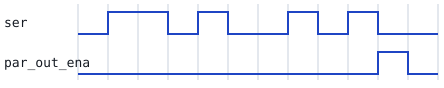

# P11 · Klausur F19: Serieller Rahmen und Sende-Prozedur

8 min · zurück: [P10](P10_tastatur_top.md) · weiter: [P12](P12_empfaenger_code.md)

## Ziel
Ein serielles Protokoll verstehen und es in der Testbench mit einer Prozedur erzeugen.

## Erklärung
Nach **F19 A1** (sinngemäß): Bytes werden einzeln über eine Leitung `ser` übertragen. Jedes Byte steckt in einem Rahmen:
- Ruhepegel `'0'`
- **Startbit** `'1'`
- 8 Datenbits, **niederwertigstes Bit zuerst**
- **Stoppbit** `'0'`

Achtung: Die Polarität ist umgekehrt wie beim UART aus M10 (dort Ruhe `'1'`, Start `'0'`). In der Klausur steht die Festlegung immer im Text – genau lesen.



Jedes Bit dauert `BIT_TAKTE` Taktperioden. Die Testbench braucht eine Prozedur, die einen kompletten Rahmen sendet. Weil sie ein Signal treibt, steht sie im Deklarationsteil des **Prozesses** (dort darf sie `ser` direkt zuweisen).

## Aufgabe
Schreibe `procedure send_byte(d : std_logic_vector(7 downto 0))` für den Testbench-Prozess. Die Konstante `T` (Taktperiode) und das Signal `ser` sind sichtbar, ein Bit dauert `8 * T`.

<details><summary>Lösung</summary>

```vhdl
procedure send_byte(d : std_logic_vector(7 downto 0)) is
begin
  ser <= '1';               -- Startbit
  wait for 8 * T;
  for i in 0 to 7 loop      -- LSB zuerst
    ser <= d(i);
    wait for 8 * T;
  end loop;
  ser <= '0';               -- Stoppbit
  wait for 8 * T;
end procedure send_byte;
```
Aufruf: `send_byte(x"A5");` – danach bleibt `ser = '0'`, das ist zugleich der Ruhepegel.
</details>

## Klausur
**F19 A1** (Rahmenformat, Testbench mit Sende-Prozedur).
