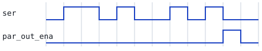

# P12 · Klausur F19: Serieller Empfänger

12 min · zurück: [P11](P11_empfaenger_rahmen.md) · weiter: [P13](P13_divstep.md)

## Ziel
Einen Empfänger mit Synchronisierer, Taktteiler und Bitzähler in **einem** getakteten Prozess schreiben.

## Erklärung


Bausteine im Prozess:
- **Synchronisierer**: `ser_in_d <= ser_in; ser_in_dd <= ser_in_d;` – nur `ser_in_dd` wird ausgewertet.
- Zustand `ruhe`: wartet auf die steigende Kante des Startbits.
- Taktteiler `teiler`: Wird beim Start auf `BIT_TAKTE / 2` gesetzt. Dann liegt jede Abtastung **in der Bitmitte** – dort ist das Signal am stabilsten, auch wenn Sender und Empfänger leicht verschiedene Takte haben.
- Bitzähler `bitnr` 0 … 9: Start, 8 Daten, Stopp. Jedes abgetastete Bit wird von links in ein Schieberegister `data(9 downto 0)` geschoben; nach 10 Bits liegt das Byte in `data(8 downto 1)`.
- `par_out_ena` ist einen Takt lang `'1'`, wenn das Byte fertig ist.

```vhdl
entity receiver is
  generic(BIT_TAKTE : positive := 8);
  port(
    clk, res_n  : in  std_logic;
    ser_in      : in  std_logic;
    par_out     : out std_logic_vector(7 downto 0);
    par_out_ena : out std_logic
    );
end entity receiver;
```

## Aufgabe
1. Schreibe `architecture behav of receiver`.
2. Warum wird das Byte von **links** in `data` geschoben?
3. Was passiert, wenn das Startbit nur einen Takt lang `'1'` ist (Störimpuls)?

<details><summary>Lösung</summary>

```vhdl
architecture behav of receiver is
  type state_type is (ruhe, empfang);
  signal state : state_type;
  signal ser_in_d, ser_in_dd : std_logic;
  signal teiler : integer range 0 to BIT_TAKTE - 1;
  signal bitnr  : integer range 0 to 9;
  signal data   : std_logic_vector(9 downto 0);
begin
  process(clk, res_n) is
  begin
    if res_n = '0' then
      state <= ruhe;
      ser_in_d <= '0';
      ser_in_dd <= '0';
      teiler <= 0;
      bitnr <= 0;
      data <= (others => '0');
      par_out_ena <= '0';
    else
      if clk'event and clk = '1' then
        ser_in_d  <= ser_in;
        ser_in_dd <= ser_in_d;
        par_out_ena <= '0';
        case state is
          when ruhe =>
            if ser_in_dd = '1' then
              state  <= empfang;
              teiler <= BIT_TAKTE / 2;
              bitnr  <= 0;
            end if;
          when empfang =>
            if teiler = BIT_TAKTE - 1 then
              teiler <= 0;
              data <= ser_in_dd & data(9 downto 1);
              if bitnr = 9 then
                state <= ruhe;
                par_out_ena <= '1';
              else
                bitnr <= bitnr + 1;
              end if;
            else
              teiler <= teiler + 1;
            end if;
        end case;
      end if;
    end if;
  end process;
  par_out <= data(8 downto 1);
end architecture behav;
```
2. Das LSB kommt zuerst. Schiebt man von links nach rechts, ist es nach 10 Schritten ganz rechts angekommen – die Bits stehen dann in der richtigen Wertigkeit.
3. Der Empfänger startet trotzdem und liest Unsinn. Abhilfe: In der Bitmitte prüfen, ob das Startbit noch `'1'` ist, sonst zurück nach `ruhe`.
</details>

## Klausur
**F19 A1** (Empfänger-Prozess, Synchronisierer, Abtastzeitpunkt). Simulierbar in `am_rechner/L12/projekte_klausur.vhd`.
