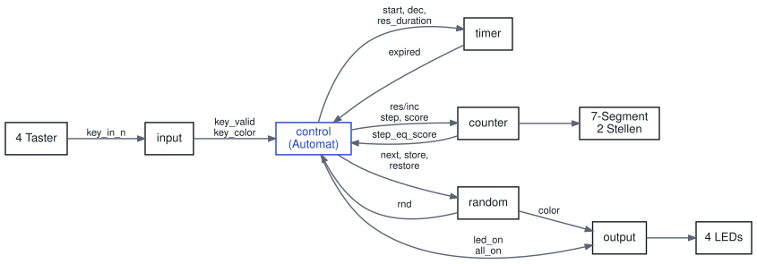

# S01 · Projekt Senso: das ganze System im Überblick

5 min · zurück: [P18](P18_kellerautomat.md) · weiter: [S02](S02_timer_konstant.md)

## Ziel
Verstehen, wie ein größeres Hardware-System in Komponenten zerlegt wird, bevor du sie einzeln programmierst.

## Erklärung
Nach **Übung 2 „Senso“** (sinngemäß): Senso ist ein Merkspiel. Das Spiel zeigt eine Folge von Farben auf vier LEDs, du drückst sie auf vier Tastern nach. Jede Runde wird die Folge um eine Farbe länger und schneller.

Die Komponenten und ihre Häppchen:
- **timer** (S02–S04): misst, wie lange eine Farbe leuchtet.
- **button** und **input** (S05–S08): Taster synchronisieren, Druck auf einen Takt verkürzen, Farbe ermitteln.
- **galois_lfsr** und **random** (S09–S13): Pseudozufallszahlen, wiederholbar per Startwert.
- **counter** (S14–S15): Schrittzähler, Punktestand, 7-Segment-Anzeige.
- **output** (S16): LEDs ansteuern.
- **control** (S17): der Automat, der alles steuert.
- **senso** (S18): alles verdrahten.

Das ist genau das Prinzip **Steuerwerk + Rechenwerk** (F06): `control` entscheidet, die anderen Komponenten führen aus und melden zurück (`timer_expired`, `step_eq_score`, `key_valid`).

## Aufgabe
1. Welche Komponenten brauchen `clk` und `res_n`, welche nicht?
2. Warum geht `rnd` sowohl an `control` als auch direkt an `output`?

Lösung

1. Alle mit Speicher brauchen Takt und Reset: `timer` (Zähler), `button`/`input` (Synchronisierer, Automat), `random` (Register), `counter` (Zähler), `control` (Zustand). `output` ist rein kombinatorisch und braucht beides nicht.
2. `output` zeigt beim Vorspielen die aktuelle Zufallsfarbe an. `control` vergleicht beim Nachspielen die gedrückte Farbe mit `rnd`. Die Farbe muss nicht durch den Automaten laufen, deshalb geht sie direkt an `output`.

## Klausur
Systeme aus mehreren Komponenten mit Steuerwerk gibt es in fast jeder Klausur (F20 A2 Tastatur, F23 A2 Synthesizer, F24 A1 CRC). Alles simulierbar in `am_rechner/L13/senso.vhd`.
