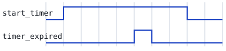

# S04 · Senso: Zeitgeber wird schneller

7 min · zurück: [S03](S03_timer_testen.md) · weiter: [S05](S05_synchronisierer_varianten.md)

## Ziel
Ein Register für die Dauer ergänzen, das schrittweise verkleinert und zurückgesetzt werden kann.

## Erklärung


Mit jeder gewonnenen Runde soll das Spiel schneller werden:
- `dec_duration = '1'`: die Dauer wird um `D_STEP` Takte kürzer, aber nie kürzer als `D_MIN`.
- `res_duration = '1'`: die Dauer springt zurück auf `D_INIT`.

Dafür kommt ein Signal `duration` dazu, das statt der Konstanten `D_INIT` verglichen wird. `res_duration` hat Vorrang. Die Prüfung „nicht unter `D_MIN`“ steht **vor** dem Abziehen, sonst würde der Wertebereich verlassen.

## Aufgabe
Erweitere die Architecture aus S02 um `duration` und die Generics `D_STEP` und `D_MIN`. Gib nur den getakteten Teil an, der `duration` setzt, und die geänderte Abfrage für das Ende.

<details><summary>Lösung</summary>

```vhdl
signal duration : integer range 1 to D_INIT;
-- im Reset-Zweig:
duration <= D_INIT;
-- in der Taktflanke, vor der Zeitmessung:
if res_duration = '1' then
  duration <= D_INIT;
elsif dec_duration = '1' and
      duration - D_STEP >= D_MIN then
  duration <= duration - D_STEP;
end if;
-- Ende der Zeit:
elsif count = duration - 1 then
```
Mit `D_INIT => 10, D_STEP => 3, D_MIN => 4` gilt: 10, dann 7, dann 4, danach bleibt es bei 4.

Ändert sich `duration`, während der Zeitgeber läuft, gilt der neue Wert sofort. Das ist hier egal, weil `control` die Dauer nur zwischen zwei Runden ändert.
</details>

## Klausur
Register mit Vorrang (`if … elsif`, D02). Simulierbar in `am_rechner/L13/senso.vhd`.
