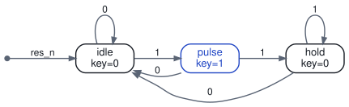

# S06 · Senso: Impulsverkürzer als Moore-Automat

9 min · zurück: [S05](S05_synchronisierer_varianten.md) · weiter: [S07](S07_button_testen.md)

## Ziel
Aus einem beliebig langen Tastendruck genau einen Takt-Impuls machen.

## Erklärung
Ein Tastendruck dauert viele Millionen Takte. Das Spiel soll ihn aber genau **einmal** zählen. Der Impulsverkürzer macht aus `tx_sync` das Signal `key`, das pro Druck genau einen Takt `'1'` ist.



Drei Zustände:
- `idle`: nichts gedrückt.
- `pulse`: gerade gedrückt worden, `key = '1'`, wird nach einem Takt **unbedingt** verlassen.
- `hold`: Taste wird noch gehalten, warten aufs Loslassen.

```vhdl
entity button is
  port(
    clk, res_n : in  std_logic;
    tx_n       : in  std_logic;
    key        : out std_logic
    );
end entity button;
```

## Aufgabe
Schreibe `architecture behav of button`: Synchronisierer (Variante a aus S05) plus Automat mit `transition_function`, `state` und dem Ausgang `key`.

<details><summary>Lösung</summary>

```vhdl
architecture behav of button is
  signal tx_1st, tx_sync : std_logic;
  type state_type is (idle, pulse, hold);
  signal current_state, next_state : state_type;
begin
  drs: process(clk, res_n) is
  begin
    if res_n = '0' then
      tx_1st  <= '0';
      tx_sync <= '0';
    else
      if clk'event and clk = '1' then
        tx_1st  <= not tx_n;
        tx_sync <= tx_1st;
      end if;
    end if;
  end process drs;

  transition_function: process(current_state, tx_sync) is
  begin
    case current_state is
      when idle =>
        if tx_sync = '1' then next_state <= pulse;
        else next_state <= idle; end if;
      when pulse =>
        if tx_sync = '1' then next_state <= hold;
        else next_state <= idle; end if;
      when hold =>
        if tx_sync = '1' then next_state <= hold;
        else next_state <= idle; end if;
    end case;
  end process transition_function;

  state: process(clk, res_n) is
  begin
    if res_n = '0' then
      current_state <= idle;
    else
      if clk'event and clk = '1' then
        current_state <= next_state;
      end if;
    end if;
  end process state;

  key <= '1' when current_state = pulse else '0';
end architecture behav;
```
Mit zwei Zuständen geht es nicht: Ohne `hold` könnte der Automat nicht unterscheiden, ob die Taste neu gedrückt oder noch gehalten wird.
</details>

## Klausur
Moore-Automat aus Text entwerfen (F02, P01). Gleiches Muster wie die Flankenerkennung in D07.
