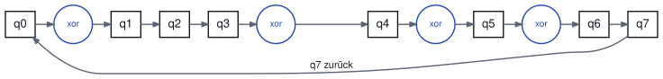

# S09 · Senso: rückgekoppeltes Schieberegister von Hand

8 min · zurück: [S08](S08_input.md) · weiter: [S10](S10_lfsr_code.md)

## Ziel
Ein Galois-LFSR (Pseudozufallsgenerator) Takt für Takt von Hand rechnen.

## Erklärung
Acht Flipflops `q7 … q0` bilden ein Schieberegister. Bei jeder Flanke:
- jedes Bit rückt eine Stelle nach links (`q(i)` bekommt `q(i-1)`),
- `q7` wandert nach `q0` (Rückkopplung),
- vor manchen Flipflops sitzt ein XOR mit `q7`. Wo, legt das Muster `fb(7 downto 1)` fest: `fb(i) = '1'` heißt „XOR vor `q(i)`“.



Jedes XOR bekommt als zweiten Eingang `q7`. Ist `q7 = '0'`, ändern die XORs nichts. Dann wird nur rotiert.

In VHDL:
```vhdl
if q(7) = '1' then
  q := (q(6 downto 0) xor fb) & q(7);
else
  q := q(6 downto 0) & q(7);
end if;
```

## Aufgabe
`fb = "0111001"`, zum Zeitpunkt n ist q = 250 = `"11111010"`.
1. Berechne die nächsten drei Werte.
2. Wie verhält sich die Schaltung danach?
3. Was passiert bei q = 0?

<details><summary>Lösung</summary>

1. Schritt für Schritt (q7 ist jeweils `1`):
   - `"1111010"` xor `"0111001"` = `"1000011"`, dazu q7 = `1` → `"10000111"` = **135**
   - `"0000111"` xor `"0111001"` = `"0111110"`, dazu `1` → `"01111101"` = **125**
   - q7 = `0`, nur rotieren: `"11111010"` = **250**
2. Es geht wieder bei 250 los: Der Zyklus hat nur die Länge **3** (250, 135, 125). Für Zufallszahlen ist das schlecht.
3. Aus 0 wird wieder 0: Ohne eine `1` ändern weder Schieben noch XOR etwas. 0 bildet einen eigenen Zyklus der Länge 1. Deshalb darf das Register nie mit 0 starten.

Jeder Zustand hat genau einen Nachfolger und genau einen Vorgänger. Das Zustandsdiagramm besteht deshalb nur aus getrennten Kreisen (Zyklen).
</details>

## Klausur
Schaltungen von Hand simulieren (D06), LFSR (D06, CRC in F24 A1).
