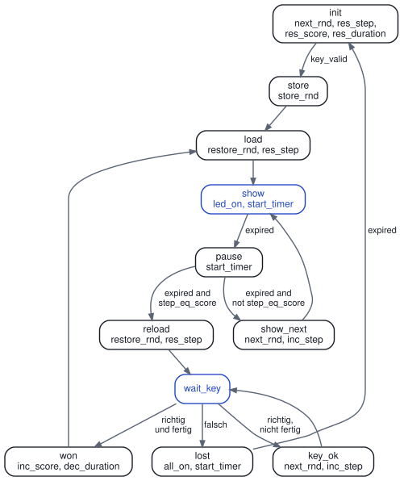

# S18 · Senso: Hauptsteuerung entwerfen

12 min · zurück: [S17](S17_output.md) · weiter: [S19](S19_steuerung_code.md)

## Ziel
Aus einer Ablaufbeschreibung einen Moore-Automaten mit allen Ausgängen entwerfen.

## Erklärung
Ablauf des Spiels:
1. Nach dem Reset wartet der Automat auf einen Tastendruck. Dabei läuft der Zufallsgenerator, die Zähler und die Spielgeschwindigkeit werden zurückgesetzt.
2. Tastendruck: Startwert merken.
3. Startwert laden, Schrittzähler auf 0.
4. Sequenz vorspielen: Farbe zeigen, Pause, nächste Farbe – bis `step = score`.
5. Startwert wieder laden, Schrittzähler auf 0.
6. Auf Tasten warten und jede prüfen:
   - falsch: alle LEDs an, Spiel verloren, zurück zu 1,
   - richtig, Sequenz noch nicht zu Ende: Schritt + 1, weiter bei 6,
   - richtig und Sequenz zu Ende: Punkte + 1, schneller, weiter bei 3.

Wichtige Regel: Signale, die etwas **einmal** auslösen (`next_rnd`, `inc_step`, `inc_score`, `dec_duration`, `store_rnd`), dürfen nur **einen Takt** aktiv sein. Zustände, in denen sie aktiv sind, werden deshalb **unbedingt** im nächsten Takt verlassen.

## Aufgabe
Ordne zu, welcher Zustand welchen Schritt umsetzt. Warum braucht man die Zustände `show_next` und `key_ok`, statt direkt in `show` bzw. `wait_key` die Zähler zu erhöhen?

Lösung

- 1 → `init`, 2 → `store`, 3 → `load`, 4 → `show`, `pause`, `show_next`, 5 → `reload`, 6 → `wait_key`, `key_ok`, `won`, `lost`.
- In `show` und `wait_key` bleibt der Automat viele Takte. Stünde dort `inc_step = '1'`, würde der Zähler in **jedem** dieser Takte hochzählen. `show_next` und `key_ok` dauern genau einen Takt und lösen die Aktion genau einmal aus.
- Gleiches gilt für `won`: `inc_score` und `dec_duration` genau einmal.

## Klausur
Steuerwerk aus Ablaufbeschreibung (F06, K02), Moore-Ausgänge pro Zustand angeben (F02).
