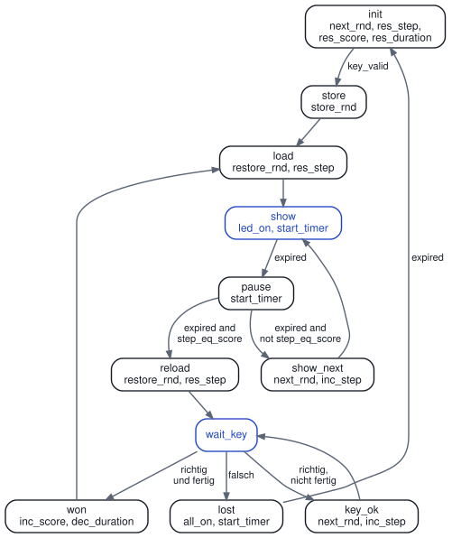

# S19 · Senso: Hauptsteuerung programmieren

14 min · zurück: [S18](S18_steuerung_entwurf.md) · weiter: [S20](S20_senso_gesamt.md)

## Ziel
Einen Moore-Automaten mit 11 Zuständen und 12 Ausgängen sauber nach Schema schreiben.

## Erklärung


```vhdl
entity control is
  port(
    clk, res_n    : in  std_logic;
    key_valid     : in  std_logic;
    key_color     : in  color_type;
    rnd           : in  color_type;
    timer_expired : in  std_logic;
    step_eq_score : in  std_logic;
    next_rnd, store_rnd, restore_rnd : out std_logic;
    res_step, inc_step               : out std_logic;
    res_score, inc_score             : out std_logic;
    start_timer, dec_duration, res_duration : out std_logic;
    led_on, all_on                   : out std_logic
    );
end entity control;
```
`color_type` ist `std_logic_vector(1 downto 0)` aus `senso_pkg`.

Bei so vielen Ausgängen hilft ein Trick in der `output_function`: **alle** Ausgänge zuerst auf `'0'`, im `case` nur die setzen, die `'1'` werden. Das ist kurz und verhindert Latches.

## Aufgabe
Schreibe `transition_function` und `output_function` (der Prozess `state` ist wie immer).

<details><summary>Lösung</summary>

```vhdl
type state_type is (init, store, load, show, pause,
  show_next, reload, wait_key, key_ok, won, lost);

transition_function: process(current_state, key_valid,
    key_color, rnd, timer_expired, step_eq_score) is
begin
  next_state <= current_state;
  case current_state is
    when init =>
      if key_valid = '1' then next_state <= store; end if;
    when store     => next_state <= load;
    when load      => next_state <= show;
    when show =>
      if timer_expired = '1' then next_state <= pause; end if;
    when pause =>
      if timer_expired = '1' then
        if step_eq_score = '1' then
          next_state <= reload;
        else
          next_state <= show_next;
        end if;
      end if;
    when show_next => next_state <= show;
    when reload    => next_state <= wait_key;
    when wait_key =>
      if key_valid = '1' then
        if key_color /= rnd then
          next_state <= lost;
        elsif step_eq_score = '1' then
          next_state <= won;
        else
          next_state <= key_ok;
        end if;
      end if;
    when key_ok => next_state <= wait_key;
    when won    => next_state <= load;
    when lost =>
      if timer_expired = '1' then next_state <= init; end if;
  end case;
end process transition_function;

output_function: process(current_state) is
begin
  next_rnd <= '0'; store_rnd <= '0'; restore_rnd <= '0';
  res_step <= '0'; inc_step <= '0';
  res_score <= '0'; inc_score <= '0';
  start_timer <= '0'; dec_duration <= '0';
  res_duration <= '0'; led_on <= '0'; all_on <= '0';
  case current_state is
    when init =>
      next_rnd <= '1'; res_step <= '1';
      res_score <= '1'; res_duration <= '1';
    when store     => store_rnd <= '1';
    when load      => restore_rnd <= '1'; res_step <= '1';
    when show      => led_on <= '1'; start_timer <= '1';
    when pause     => start_timer <= '1';
    when show_next => next_rnd <= '1'; inc_step <= '1';
    when reload    => restore_rnd <= '1'; res_step <= '1';
    when wait_key  => null;
    when key_ok    => next_rnd <= '1'; inc_step <= '1';
    when won       => inc_score <= '1'; dec_duration <= '1';
    when lost      => all_on <= '1'; start_timer <= '1';
  end case;
end process output_function;
```
Die Farbe an den LEDs kommt direkt aus `random` (`rnd` an `output`). Der Automat schaltet nur `led_on` ein und bleibt damit ein Moore-Automat.
</details>

## Klausur
Großer Automat nach Schema (F02, F05, K02, P03). Simulierbar in `am_rechner/L13/senso.vhd`.
