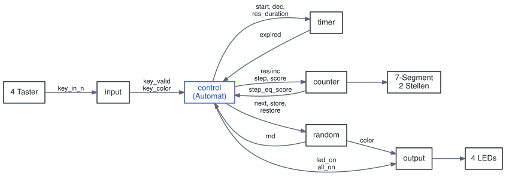

# S20 · Senso: alles verbinden und das Spiel testen

12 min · zurück: [S19](S19_steuerung_code.md) · weiter: [W01](W01_werkstatt_start.md)

## Ziel
Ein komplettes System verdrahten und mit einer Testbench „spielen“.

## Erklärung


Top-Level `senso`:
```vhdl
entity senso is
  generic(
    D_INIT : positive := 25_000_000;
    D_STEP : positive := 2_500_000;
    D_MIN  : positive := 5_000_000
    );
  port(
    clk, res_n : in  std_logic;
    key_in_n   : in  std_logic_vector(3 downto 0);
    leds       : out std_logic_vector(3 downto 0);
    score_low, score_high : out seg7_type
    );
end entity senso;
```
Die Generics reicht `senso` an `timer` durch. So läuft die Simulation mit `D_INIT => 12` statt 25 Millionen Takten.

Die Testbench spielt wie ein Mensch:
1. `zuschauen(n)`: wartet, bis eine LED leuchtet, merkt sich die Farbe, wartet bis sie ausgeht – n Mal.
2. Die Pause abwarten, dann die gemerkten Farben drücken.
3. Nach jeder Runde den Punktestand an der 7-Segment-Anzeige prüfen.
4. Zum Schluss absichtlich falsch drücken: Alle LEDs müssen leuchten, danach steht der Punktestand wieder auf 0.

## Aufgabe
Schreibe `architecture struct of senso` mit den Instanzen `input`, `control`, `timer`, `counter`, `random`, `output`.

<details><summary>Lösung</summary>

```vhdl
architecture struct of senso is
  signal key_valid, timer_expired : std_logic;
  signal step_eq_score : std_logic;
  signal key_color, rnd : color_type;
  signal next_rnd, store_rnd, restore_rnd : std_logic;
  signal res_step, inc_step : std_logic;
  signal res_score, inc_score : std_logic;
  signal start_timer, dec_duration : std_logic;
  signal res_duration, led_on, all_on : std_logic;
begin
  i_input: entity work.input
    port map(clk => clk, res_n => res_n,
             key_in_n => key_in_n,
             key_valid => key_valid, key_color => key_color);
  i_control: entity work.control
    port map(clk => clk, res_n => res_n,
             key_valid => key_valid, key_color => key_color,
             rnd => rnd, timer_expired => timer_expired,
             step_eq_score => step_eq_score,
             next_rnd => next_rnd, store_rnd => store_rnd,
             restore_rnd => restore_rnd,
             res_step => res_step, inc_step => inc_step,
             res_score => res_score, inc_score => inc_score,
             start_timer => start_timer,
             dec_duration => dec_duration,
             res_duration => res_duration,
             led_on => led_on, all_on => all_on);
  i_timer: entity work.timer
    generic map(D_INIT => D_INIT, D_STEP => D_STEP,
                D_MIN => D_MIN)
    port map(clk => clk, res_n => res_n,
             start_timer => start_timer,
             dec_duration => dec_duration,
             res_duration => res_duration,
             timer_expired => timer_expired);
  i_counter: entity work.counter
    port map(clk => clk, res_n => res_n,
             res_step => res_step, inc_step => inc_step,
             res_score => res_score, inc_score => inc_score,
             step_eq_score => step_eq_score,
             score_low => score_low, score_high => score_high);
  i_random: entity work.random
    port map(clk => clk, res_n => res_n,
             next_rnd => next_rnd, store_rnd => store_rnd,
             restore_rnd => restore_rnd, rnd => rnd);
  i_output: entity work.output
    port map(led_on => led_on, all_on => all_on,
             color => rnd, leds => leds);
end architecture struct;
```
Zählt man die Signale: Jede Verbindung zwischen **zwei Instanzen** braucht ein internes Signal. Ports von `senso` werden direkt angeschlossen.
</details>

## Klausur
Top-Level verdrahten (G01, P10, L10). Das ganze Spiel simulierst du mit `./sim.sh tb_senso am_rechner/L13/senso.vhd am_rechner/L13/tb_senso.vhd`.
